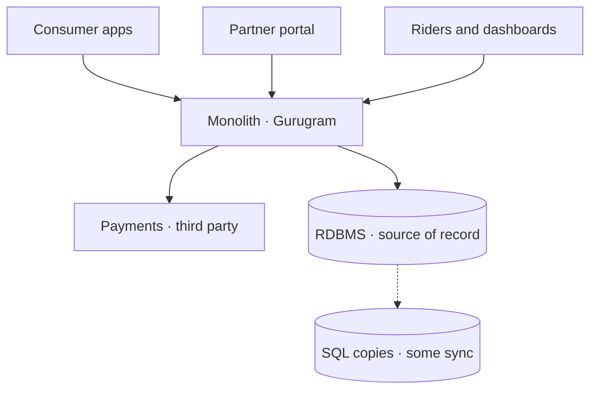
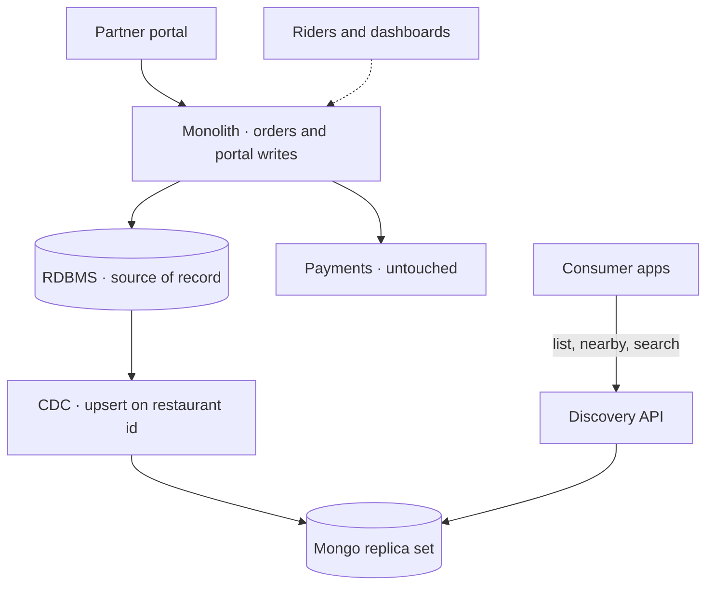
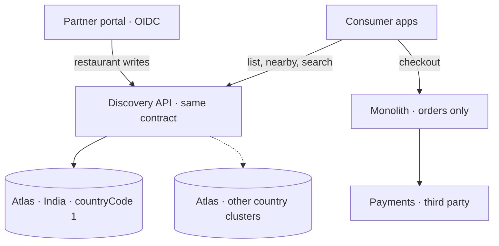
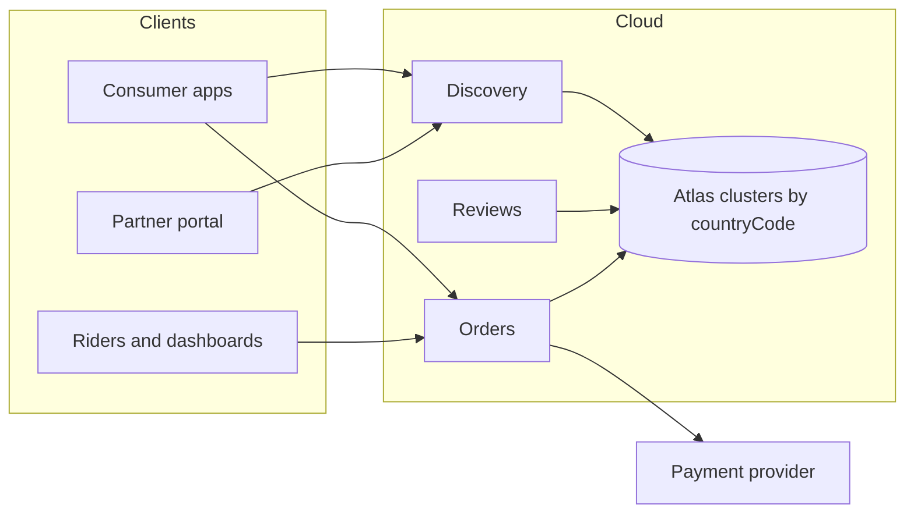

# FDA plan

Two horizons. The next 6–12 months take the peak-hour list off the Gurugram monolith. The following two years finish the restaurant migration onto Atlas, then repeat that pattern for the rest of the platform.

Orders stay on the monolith until they have their own design. Payments stay with the provider BiteExpress already uses. This repo is the discovery slice those later moves build on. What is running today vs only written down: [scope.md](scope.md). The short version: [architecture.md](architecture.md).

## Where I start

Every client hits a multi-instance monolith in Gurugram. Some SQL copies already sync. The list at lunch and dinner is the read that loses orders before checkout runs.

The running MVP is the discovery API on MongoDB 7, seeded from the Zomato CSV. List, nearby, and sentence search share one pipeline. Nothing is wired to the monolith yet. `POST /v1/restaurants` exists so the demo can create a restaurant with no portal attached. Production writes do not use it until the long-term cutover below.

## 6–12 months

Goal from the brief: reliability and performance at peak, so a slow restaurant list stops costing orders.

At the end of this window, consumer discovery reads Mongo in production. The partner portal still writes the RDBMS. The RDBMS is still the source of record. Checkout never calls this API.

### Sequence

| When | What I do | Done when |
|---|---|---|
| Now | Keep the API, the document, and the indexes from this repo. `_id` is the monolith Restaurant ID | GET by id matches the id the portal already uses |
| Month 1–2 | Debezium, or the same idea, from the Gurugram RDBMS. Upsert with `replaceOne({_id})`. A failed apply retries from the log offset | Portal commit succeeds even when Mongo is behind. Lag is seconds, and it is measured |
| Month 2–3 | Replica set. List uses `secondaryPreferred`. Primary keeps ingest and the rare POC write | Lunch read traffic has a secondary. Compose’s single node is only the demo |
| Month 3–4 | Shadow a percentage of `GET /v1/restaurants*` and compare counts, ids, and distances with the old list | Mismatch rate is understood. Geo rows with no point stay absent, same as ingest dropping `(0,0)` |
| Month 4–6 | Flip consumer list, nearby, and search | The old list path is idle for those calls. Orders and the portal are unchanged |
| Through month 12 | Watch the indexes and the deep pages. Size stays capped at 100. Move to a cursor, or cache the first page of a city, only after offset time or a hot key shows up | Peak list latency is off the monolith. The Java thread pool is not the thing we scaled |

I leave dual-write out. The portal does not call Mongo inside the request. I use dual-write only if the measured CDC lag is itself losing the list, and only with an outbox. Writing Mongo first is not that fallback. The monolith still owns the flags that sit next to payments.

I leave a big-bang cutover out. The old write path keeps serving. Discovery can be stale. Checkout cannot be down.

Sentence search stays the parser in this process. It fills the same `RestaurantQuery` as the filter API. Atlas Search is the next horizon, not this one.

## 2–3 years: full migration

Goal from the brief: cloud-native, more countries, and data-residency rules.

“Full” here is the restaurant domain first, then the same strangler for the next domains. I do not empty the monolith into one cluster. Payments are already outside. Orders move only when their own slice is designed, because they sit next to those payments.

### Restaurants finish moving

This is the cut that makes Mongo the source of record for restaurants and turns CDC off.

| When | What I do | Done when |
|---|---|---|
| Early | Move the deployment to Atlas in India. Same documents, new connection string. Encryption at rest and backups come with the cluster | Gurugram Mongo is gone. The API contract is unchanged |
| With Atlas | Replace the parser with Atlas Search on the same collection. Search still ends in `RestaurantQuery` | The three example sentences, plus synonyms, rank without the hand-written parser |
| After reads have been stable | Portal restaurant writes go to this API. Shadow the writes against the RDBMS, then flip. CDC stops. SQL restaurant master becomes read-only, then drops | A partner edit is visible on the list without a stream. `_id` values already match, so the flip does not renumber restaurants |
| With the write flip | `POST /v1/restaurants` becomes the real create path. The counter stays clear of ids the source data already used | No second writer remains for the catalogue |
| As countries open | `countryCode` picks the cluster. Code 1 stays in India. The resource does not grow a region branch | A new country is a cluster and a routing rule, not a backfill |
| When diners can write reviews | A `reviews` collection, with the aggregate still copied onto the restaurant for the city + rating sort | Review history has its own retention. The hot list still hits one index |

Partner login stays OIDC on the portal. This API remains a catalogue. Search latitude stays a query parameter and is never stored on the restaurant. mTLS is inside the cluster. I put API keys on this process only if it is exposed beyond the platform network.

### The rest of the platform

After restaurants, I use the same shape: a read model first, CDC while the monolith still writes, shadow, flip reads, then move the writer and retire the stream.

| Domain | What I do with it | Why this order |
|---|---|---|
| Restaurants | Finished in the steps above | The peak read, and the slice this repo already proves |
| Reviews | Own collection once diners write them | The CSV rating is one snapshot. Per-diner history is a different write rate and a different retention rule |
| Menus and availability | Next read-heavy partner data, same CDC then write cutover | Still catalogue. Still not an order |
| Orders | Own service, own store, after the payment boundary is explicit | An order must not depend on discovery lag, and must not share a document with the public catalogue |
| Riders and dashboards | Read models off the order and restaurant streams | They follow the writers. They do not lead the migration |
| Payments | Stay with the current provider | Already out of the monolith. No Mongo plan for the charge itself |

The monolith is gone when the last writer has a new home. Until then it keeps orders and any portal screen that has not moved. Each retired table is a cutover with a shadow compare, not one release that moves the portal, the reports, and checkout together.

### End state

India restaurant documents live on the India cluster. Another country is another cluster. Diner profiles, if they exist by then, are their own collection with their own residency and erasure. They never land on `restaurants`.

## Document I need for both horizons

One `restaurants` collection. The 6–12 month stream and the later write cutover use the same shape, so I do not migrate the document twice.

| Field | Shape | Why it has to exist now |
|---|---|---|
| `_id` | Long, source Restaurant ID | CDC upsert now, and the portal write flip later, are the same key |
| `location` | GeoJSON Point, longitude first | `$geoNear` first, 2dsphere index. `(0,0)` from the CSV is dropped |
| `rating` | Nested aggregate, votes, text | City + rating index for the peak list |
| `cuisines` | Array of strings | Multikey filter on the card |
| `nameLower` | Stored string | Case-insensitive name sort |
| `flags` | Booking, delivery, delivering now | Read with the card while the monolith still owns them |
| `countryCode` | Number, plus country name | The long-term cluster route. Adding it after CDC has copied the collection would be a backfill |
| `avgCostForTwo` | Number | “Under Rs. 1000 for two”. List accepts `maxCostForTwo` and returns the cost on the row |

## Choices I will defend

| Topic | 6–12 months | Full migration |
|---|---|---|
| Source of record | RDBMS. Discovery may lag by seconds | MongoDB on Atlas, after the portal write flip. CDC then stops |
| How data moves | CDC upsert on `_id`. Portal does not know about Mongo | Portal writes this API. SQL restaurant tables go read-only, then drop |
| Peak | Replica set, indexes, size cap 100. Cursor and Redis only after a measurement | Secondaries stay. Atlas Search replaces the parser |
| Search | Deterministic parser into `RestaurantQuery` | Atlas Search fills that same object. A model, if added, may only fill those fields |
| Compliance | Catalogue only. No diner coordinates stored | India cluster for `countryCode` 1. Diner data is a different collection |
| Security | Mongo port unpublished. No API keys on a public catalogue | OIDC on the portal. mTLS and encryption at rest on Atlas |
| Orders and payments | Untouched | Orders get their own slice later. Payments stay with the provider |

ADRs: [001](adr/001-quarkus-over-spring.md) Quarkus, [002](adr/002-document-model-and-ids.md) document and ids, [003](adr/003-geo-and-indexes.md) geo and indexes, [004](adr/004-nl-search-without-atlas.md) sentence search, [005](adr/005-coexistence-and-cdc.md) coexistence, [006](adr/006-peak-traffic-and-pagination.md) peak and pagination, [007](adr/007-security-and-compliance.md) security and compliance, [008](adr/008-layered-not-hexagonal.md) layered packages.
